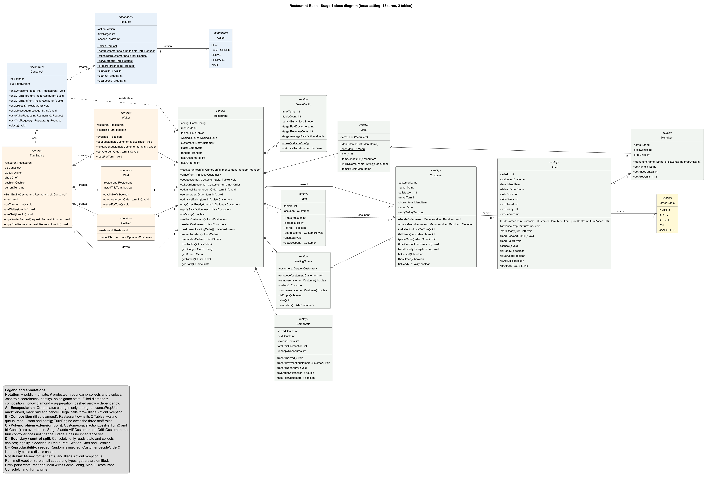

# Stage 1 class diagram



| File | Purpose |
| --- | --- |
| [`stage-1-classes.puml`](stage-1-classes.puml) | PlantUML source. Edit this file, then re-render. |
| [`stage-1-classes.svg`](stage-1-classes.svg) | Vector image. Use this in the PDF report. |
| [`stage-1-classes.png`](stage-1-classes.png) | Raster preview (4380 x 2953 at 150 dpi). |

Rendered with PlantUML 1.2024.7 and Graphviz 16.1.0.

## Scope: Stage 1 only, not the final report diagram

The brief (Section 5) asks for a class diagram of the **final design, matching the Stage 3 code**. This diagram is the design contract for the `stage-1` tag. It deliberately contains no `VIPCustomer`, `CriticCustomer`, `Host`, `ComboMeal` or Happy Hour code.

Update this diagram at every tag. The report needs the Stage 3 version, where inheritance and the new roles finally appear. Section "How this diagram evolves" lists the expected additions.

## How to read the notation

| Notation | Meaning in this diagram |
| --- | --- |
| `+` / `-` | public / private member (UML visibility) |
| `<<boundary>>` | UI class: collects manager input and displays state |
| `<<control>>` | coordinator class: turn flow and staff actions |
| `<<entity>>` | domain class: owns game state and rules |
| Filled diamond | composition: the part is created and destroyed with the whole |
| Hollow diamond | aggregation: the whole references parts that can exist elsewhere |
| Solid arrow | association, navigable in the arrow direction |
| Dashed arrow | dependency (`..>`) |
| `1`, `0..1`, `2`, `0..*` | multiplicities at each end |

Inheritance is absent on purpose: Stage 1 has no subclasses yet. The first `<|--` arrow appears in Stage 2.

## Layer map and responsibilities

| Class | Layer | Responsibility |
| --- | --- | --- |
| `ConsoleUI` | boundary | Renders the start-of-turn state, end-of-turn summary and result; reads and parses manager input; re-prompts after a rejected choice. Holds **no game rules**. |
| `Request` | boundary helper | Carries one manager decision: an `Action` plus up to two target numbers (queue index, table id or order id). |
| `Action` | enum | `SEAT`, `TAKE_ORDER`, `SERVE`, `PREPARE`, `WAIT`. |
| `TurnEngine` | control | Runs the 18-turn loop and the six steps in order. Applies the Waiter request, then the Chef request, then triggers eating, payment, satisfaction loss and the result check. |
| `Waiter` | control | At most one task per turn: seat one queued customer, take one seated customer's order, or serve one already-READY order. Refuses a second task. |
| `Chef` | control | At most one preparation unit per turn, on the order the manager chooses. |
| `Cashier` | control | Fully automatic: pays at most one customer who was already READY_TO_PAY, oldest first. |
| `Restaurant` | entity (aggregate) | Owns tables, queue, menu, stats, config and present customers. Validates and performs every state transition; throws `IllegalActionException` when a rule would be broken. |
| `Customer` | entity | Identity, satisfaction, arrival turn, chosen dish, current order and ready-to-pay turn. Exposes the overridable behaviour hooks used in Stage 2. |
| `Order` | entity | Order lifecycle and preparation progress; stores the locked price and the turn stamps `turnPlaced`, `turnReady`, `turnServed`. |
| `OrderStatus` | enum | `PLACED`, `READY`, `SERVED`, `PAID`, `CANCELLED`. |
| `Menu` | entity | The three base items and lookup by name or index. |
| `MenuItem` | entity | Name, price in **integer cents**, preparation units. |
| `Table` | entity | Holds zero or one customer until payment or abandonment frees it. |
| `WaitingQueue` | entity | FIFO of customers who have arrived but are not seated. |
| `GameStats` | entity | Served count, paid count, revenue cents, sum of paid satisfaction, unhappy departures, average. |
| `GameConfig` | entity | The reproducible base setting: 18 turns, 2 tables, arrival turns 1/4/7/10/13/16, and the victory targets. |

Two supporting types are intentionally left off the drawing to keep it readable: `Money.format(int cents)` for `$0.00` output, and `IllegalActionException` (a `RuntimeException`) for rejected actions. `Main` only wires `GameConfig`, `Menu`, `Restaurant`, `ConsoleUI` and `TurnEngine` together.

## Rules encoded in the model

These are the decisions the class structure is built to enforce. They are the ones worth writing up in the design discussion.

1. **Order owns its lifecycle.** `status` is only changed by `advancePrepUnit`, `markServed`, `markPaid` and `cancel`; `markReady` is private. Illegal transitions throw, so no caller can smuggle an order into `PAID` from `PLACED`.
2. **One active order per customer.** `Customer "1" -- "0..1" Order`. The customer keeps a reference so display and payment never have to search a global order list.
3. **Price is locked at order time.** `Order.priceCents` is supplied by `Customer.billCents(item)` when the order is created. Stage 3's Happy Hour can discount without repricing old orders.
4. **Turn stamps, not booleans.** `turnReady`, `turnServed` and `Customer.readyToPayTurn` encode the three one-turn delays. `Restaurant.serve` requires `turnReady < turn`, so an order finished this turn cannot be served until the next. The Cashier's rule is exactly `readyToPayTurn < turn`, so a customer who became ready this turn cannot pay until the next.
5. **Satisfaction is encapsulated.** Only `Customer.loseSatisfaction` lowers it, clamped at 0; `Restaurant` decides *who* loses points, the customer decides *how much* (`satisfactionLossPerTurn`, currently 8).
6. **Staff enforce their own capacity.** `Waiter` and `Chef` keep `actedThisTurn` and expose `available()`. A rejected request never consumes the action, which is what makes "explain and re-prompt" easy.
7. **Money is integer cents everywhere.** Only the boundary formats it, through `Money.format`.
8. **Reproducibility.** `Restaurant` holds an injected seeded `Random`; only `Customer.decideOrder` consumes it, so a recorded seed reproduces every dish choice.

## Mapping to the marking criteria (Section 5)

| Requirement | Where it is satisfied |
| --- | --- |
| Principal entity classes | `Restaurant`, `Customer`, `Order`, `MenuItem`, `Menu`, `Table`, `WaitingQueue`, `GameStats`, `GameConfig` |
| Control classes | `TurnEngine`, `Waiter`, `Chef`, `Cashier` |
| Boundary class | `ConsoleUI` (with `Request` and `Action`) |
| Relevant enums | `OrderStatus`, `Action` |
| Attributes and operations with visibility | All compartments show `+` / `-`; `#` marks the protected `chooseMenuItem` hook. Private fields are exposed only through operations. |
| Inheritance | Not present in Stage 1; introduced in Stage 2 (see below). The final report diagram must show it. |
| Associations with multiplicities | `Restaurant 1-2 Table`, `Customer 1-0..1 Order`, `Order *-1 MenuItem`, `Menu 1-3 MenuItem`, `WaitingQueue 1-0..* Customer`, `Table 1-0..1 Customer`, `ConsoleUI 1-0..* Request` |
| Encapsulation annotation | **A** in the diagram legend, plus rules 1, 4 and 5 above |
| Composition annotation | **B**: filled diamonds from `Restaurant` (tables, queue, menu, stats, config) and `TurnEngine` (three staff roles) |
| Polymorphism annotation | **C**: `Customer.satisfactionLossPerTurn()` and `billCents()` are the Stage 2 dispatch points; no `instanceof` chains in `TurnEngine` |

## One turn, expressed through these objects

This bridges the class diagram to the sequence diagram you need later.

| Brief step | Object messages |
| --- | --- |
| Start-of-turn display | `ConsoleUI.showTurnStart(turn, restaurant)` |
| 1 Arrivals | `Restaurant.arrive(turn)` creates scheduled `Customer`s, calls `Customer.decideOrder(menu, random)`, adds them to `WaitingQueue` |
| 2 Manager choices | `ConsoleUI.askWaiterRequest(restaurant)` returns a `Request`; `TurnEngine.applyWaiterRequest` calls `Waiter.seat` / `takeOrder` / `serve`, each delegating to `Restaurant`. `Waiter.takeOrder` returns the new `Order`, so the engine can display the chosen dish and locked price immediately. Then the Chef request reaches `Chef.prepare` and `Order.advancePrepUnit`. |
| 3 Kitchen and serving | The Waiter acted first, so serving requires an order that was already `READY`; the Chef's unit this turn can only make an order ready for the *next* turn. |
| 4 Eating and payment | `Restaurant.advanceEating(turn)` (served before this turn becomes `READY_TO_PAY`), then `Cashier.collectNext(turn)` → `Restaurant.payOldestReady(turn)` |
| 5 Waiting and abandonment | `Restaurant.applySatisfactionLoss()` calls `Customer.loseSatisfaction` on unserved customers, then cancels orders and frees tables for anyone who reached 0 |
| 6 Result | `ConsoleUI.showTurnEnd`; after turn 18, `Restaurant.isVictory()` → `ConsoleUI.showResult` |

The order inside step 4 matters: eating is advanced **before** the Cashier looks for customers, so a customer who becomes ready during this turn is excluded by the strict `<` comparison.

## How this diagram evolves

**Stage 2.** `Customer` becomes the base class; `VIPCustomer` and `CriticCustomer` extend it and override `satisfactionLossPerTurn()` (5 and 12) and `billCents()` (VIP 90%). A Critic gets one documented preference or reaction field. `TurnEngine`, `Waiter`, `Chef` and `Cashier` are expected to stay unchanged, which is the concrete OCP evidence for the report. An inheritance arrow appears here for the first time.

**Stage 3.** `Host` joins the control layer with its own one-seat-per-turn capacity. `ComboMeal` is a menu item built from two existing items (summed preparation units, 90% of the combined price). Happy Hour becomes a pricing policy applied when the order is priced, plus a remaining-duration field and a satisfaction recovery step at turn start. The exact class shapes are decided when we build Stage 3; this section is a preview, not a commitment.

At every tag: edit the `.puml`, re-render, and keep the annotation letters pointing at the real code.

## Regenerating the image

The source uses `@startuml` without a name, so the output file name follows the `.puml` file name. If you add a name, PlantUML writes `<name>.png` instead.

```powershell
# one-time tools (versions used here)
# PlantUML: https://repo1.maven.org/maven2/net/sourceforge/plantuml/plantuml/1.2024.7/plantuml-1.2024.7.jar
# Graphviz: https://gitlab.com/api/v4/projects/4207231/packages/generic/graphviz-releases/16.1.0/windows_10_cmake_Release_Graphviz-16.1.0-win64.zip

# Graphviz's bin folder must be on PATH (or set GRAPHVIZ_DOT to dot.exe).
$env:PLANTUML_LIMIT_SIZE = "20000"   # otherwise PlantUML clips at 4096 px
java -Djava.awt.headless=true -jar plantuml.jar -tpng -charset UTF-8 docs/uml/stage-1-classes.puml
java -Djava.awt.headless=true -jar plantuml.jar -tsvg -charset UTF-8 docs/uml/stage-1-classes.puml
```

`PLANTUML_LIMIT_SIZE` matters: without it the diagram is silently cut off at 4096 px and the enum and legend disappear. Without Graphviz, PlantUML falls back to its internal layout engine and the result looks different.

## Checks before this goes in the report

- [ ] Diagram is regenerated from the **Stage 3** code, not this Stage 1 version.
- [ ] Every class, attribute and operation drawn exists in the source.
- [ ] Inheritance arrows for `VIPCustomer` and `CriticCustomer` are present and their overrides are visible.
- [ ] Every association has the correct multiplicity at both ends.
- [ ] Annotations A-E still point at real code (encapsulation, composition, polymorphism).
- [ ] The caption in the PDF explains the colour layers and the A-E letters.
